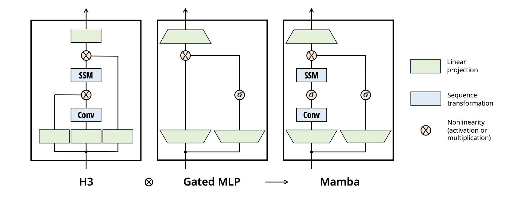

**Albert Gu and Tri Dao · 2024** · [Paper](https://arxiv.org/abs/2312.00752)

Mamba makes state space models input-dependent, so they can select what to remember while keeping computation linear in sequence length. These are my notes on how it gets there, from recurrent and convolutional views of SSMs to parallel scans and GPU memory.

## Sequence Modelling

The goal of sequence modelling is to transform some continuous input signal \(x(t)\) to some continuous output signal \(y(t)\), or some discrete input sequence to a discrete output sequence.
### RNNs
An RNN has a theoretically infinite context window, though in practice suffers from vanishing/exploding gradients. Training is \(O(n)\), and **not parallelisable**. It has constant time inference per token.

### CNNs
Finite context window, training and inference depend on kernel size. It is easily parallelisable.

### Transformers
A finite context window model that trains in \(O(N^2)\) but is **easily parallelisable**.
It has an inference per token of \(O(n)\) when using a KV cache.

Ideally, we would like to have a model which is parallelisable during training like a Transformer, can scale linearly to large sequences with the cost of an RNN, and can infer each token in \(O(1)\).

## State Space Models
We map an input signal \(x(t)\) to an output signal \(y(t)\) by means of state representation \(h(t)\) as follows:
$$\begin{align}
h'(t) &= \mathbf Ah(t)+\mathbf Bx(t) \\
y(t) &=\mathbf Ch(t) + \mathbf Dx(t)
\end{align}$$
This state space model is linear and time invariant.

This is itself an interesting system because it allows us to represent information incorporation \(h'(t)\) as some linear combination of the existing state and new input.

Let us consider all terms as scalars instead of vectors for now.

This system may be hard to solve analytically. We can therefore consider a discretisation of our system. Instead of finding \(h(t) \  \forall t\in \mathbb R\), let us sample at time steps separated by \(\Delta\) and apply Euler's method.

$$\begin{align}
h(t + \Delta)  & = \Delta(Ah(t) + Bx(t)) + h(t) \\
 & = (I + \Delta A)h(t) + \Delta Bx(t) \\
 & =\overline Ah(t) + \overline Bx(t)
\end{align}$$
In the paper the **Zero-order Hold** method is applied instead of Euler's method.

Hence we have the discrete system:
$$\begin{align}
h_{t} = \overline {\mathbf A}h_{t-1} + \overline{\mathbf B}x_{t} \\
y_{t}={\mathbf C}h_{t}
\end{align}$$
We omit the direct \(Dx_t\) term for simplicity and initialise the state before the first input as \(h_{-1}=0\).
$$\begin{align}
h_{0}&=\overline Bx_0 \\
y_{0} & =Ch_{0}
\end{align}$$
This gives us a recurrent formula to calculate the output of a system at various time steps, similar to an RNN. This is great because we take constant time and space per token generated. However, this recurrent formulation is **not** good for training since we already have all the tokens of the input and target so we want to parallelise the computation, like the transformer.

Observe that we can generalise the output expression for some \(y_t\) as such:
$$y_{k}=C\overline A^k\overline Bx_{0}+C\overline A^{k-1}\overline Bx_{1}+\dots+C\overline A \overline Bx_{k-1} +C\overline Bx_{k}$$
Notice that we can actually write this as some convolution \(\mathbf{\overline K}\) such that
$$\mathbf{\overline K}=(C\overline B, C\overline A\overline B, \dots, C\overline A^k\overline B, \dots)$$
$$y = x * \mathbf{\overline K}$$
Great! As we recall, convolution is great because it does not require computing previous output states first. However, building this kernel is quite expensive. Hence at train time we train using these parallel convolutions but run inference using our discrete recurrent steps.

Now consider a multidimensional dataset. For instance, we can have some \(n\)-dimensional embedding. We have essentially an independent state space model for each dimension. If this seems weird, remember that in transformers we break up the dimensions into heads as well!

## HiPPO Matrix
As you may have guessed our \(\mathbf{\overline A}\) matrix is extremely important. It is essentially what synthesises the previous information and decides which information to retain.

We can consider building that matrix in such a way that it summarises the input history using coefficients of orthogonal polynomials, such as Legendre polynomials. The weighting of older inputs depends on the HiPPO formulation.

HiPPO motivates the initialisation used in earlier SSMs such as S4; Mamba also explores simpler initialisations of \(\mathbf A\).

## Motivation
Two tasks present difficulty to SSMs in the prior literature that motivate Mamba.

One revolves around copying, where we want \(y(t) = x(t - \Delta)\) which can be learnt in convolution. However, it struggles with selective copying, where we want some subsequence of \(x(t)\), such as filtering out bad words on a Twitter post.

The second is induction: after seeing a pair of tokens earlier in the sequence, the model should predict the second token when the first appears again. For example, having seen a black token followed by a blue token, it should recall blue when black reappears.

## Mamba
Now let’s consider that we may want to incorporate information differently given each input signal, and similarly we may want to read information out differently. Hence let us fix \(\mathbf A\), but now have \(\Delta, \mathbf B, \mathbf C\) depend on learned projections of the input (with a softplus transformation to keep \(\Delta\) positive) and hence derive \(\mathbf{\overline A}\) and \(\mathbf {\overline B}\) through our discretisation relations.

This breaks our convolution strategy for parallelising our training since we can no longer precalculate a kernel since it is input-dependent.

Consider prefix sum. We can easily and linearly compute the sum of all previous values. The SSM recurrence can be represented as a sequence of affine transformations \(h\mapsto A_th+b_t\). Since composition of affine transformations is associative, all prefix states can be computed using a parallel scan.

A work-efficient parallel scan uses \(O(N)\) total work and \(O(\log N)\) parallel depth. With \(T\) workers, the idealised running time is \(O(N/T + \log N)\).

## GPU Memory Hierarchy
When computation needs to be done, data will be taken from High Bandwidth Memory (DRAM) to a smaller SRAM memory store. The copying from HBM to SRAM is slow, and is actually much slower than the speed at which the GPU cores can perform operations. We call this **IO-bound**.

To take advantage of the fast SRAM, the authors take in the parameters from HBM, and perform the discretisation and recurrence in SRAM and only write the final results back to HBM. By taking multiple kernels and writing them as one to prevent redundant overhead, we are performing **kernel fusion**.

Since having to store backpropagation related information is slow, the authors suggest to simply recompute these during the backwards layer since the memory latency exceeds the compute latency in this situation.

## Mamba Architecture
Mamba is built by stacking Mamba blocks. We can do this by using a linear projection from the model dimensions to some inner dimension. The linear projections mix channels, while a short depthwise convolution mixes nearby sequence positions within each channel. We can perform SiLU activation on our tensor and feed it into the SSM. Then activation / multiplication can be performed with projected input, after which we project it out back into the expected dimensions.

## Credits
Gu, A. and Dao, T. (2024). _Mamba: Linear-Time Sequence Modeling with Selective State Spaces_. [online] Available at: https://arxiv.org/pdf/2312.00752 [Accessed 29 Sept. 2026].

Umar Jamil (2024). _Mamba and S4 Explained: Architecture, Parallel Scan, Kernel Fusion, Recurrent, Convolution, Math_. Available at: https://www.youtube.com/watch?v=8Q_tqwpTpVU [Accessed 29 Sept. 2026].
